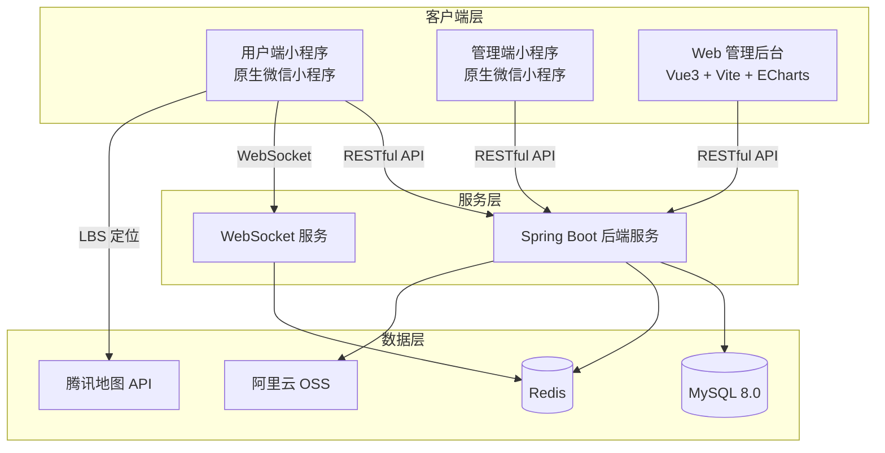

# 基于微信小程序的社区社交平台

<div align="center">


一个面向社区居民的社交互动平台，提供图文内容分享、邻里互动、即时通讯与内容安全管理的一站式解决方案。

</div>

---

## 目录

- [项目简介](#项目简介)
- [项目特性](#项目特性)
- [技术栈](#技术栈)
- [功能模块](#功能模块)
- [系统架构](#系统架构)
- [目录结构](#目录结构)
- [快速开始](#快速开始)
- [核心功能实现](#核心功能实现)
- [数据库设计](#数据库设计)
- [界面预览](#界面预览)
- [待优化项](#待优化项)
- [安全提示](#安全提示)

---

## 项目简介

本项目是一个基于 **微信小程序 + Spring Boot** 开发的社区社交平台，旨在为社区居民搭建一个便捷的线上交流社区。居民可以通过小程序发布图文动态、参与邻里互动、进行实时私信聊天；平台管理员通过管理端小程序对内容进行审核与管理；超级管理员通过 Web 后台查看平台运营数据。

系统采用 **前后端分离** 架构，共包含四个端：

| 端        | 技术                     | 说明                               |
| -------- | ---------------------- | -------------------------------- |
| 用户端小程序   | 原生微信小程序                | 面向居民，提供内容发布、互动与聊天                |
| 管理端小程序   | 原生微信小程序                | 面向管理员，提供内容审核与用户管理                |
| Web 管理后台 | Vue 3 + Vite + ECharts | 面向超级管理员，提供数据统计与系统管理              |
| 后端服务     | Spring Boot            | 三端共用的 RESTful API 与 WebSocket 服务 |

---

## 项目特性

- 🔐 **三级角色权限体系**：基于 Spring Security + JWT 实现无状态认证，通过 AOP 自定义注解实现「居民 / 管理员 / 超级管理员」三级角色的接口级访问控制。
- 💬 **实时消息推送**：基于 WebSocket 实现私信、点赞/评论/收藏、系统通知等实时推送，客户端封装心跳保活与断线自动重连。
- 📥 **离线消息不丢失**：利用 Redis List 构建离线消息队列，用户离线时消息入队，上线后自动补发并清理。
- 🚫 **敏感词过滤**：手写 DFA（Trie 树）算法，时间复杂度 O(n)，支持词库动态增删与热更新。
- ✅ **内容审核闭环**：「先审后发」审核流程，覆盖帖子、评论、实名认证三类内容，审核结果实时反馈作者。
- 📍 **基于 LBS 的社区定位**：接入腾讯地图 API，实现「附近帖子」按距离排序与发布位置标记。
- ❄️ **分布式 ID 生成**：引入雪花算法（Snowflake）生成全局唯一 ID。
- 📊 **数据可视化**：基于 ECharts 实现多维度运营数据报表。

---

## 技术栈

### 后端

| 技术                    | 用途              |
| --------------------- | --------------- |
| Spring Boot 2.7.0     | 应用框架            |
| MyBatis               | ORM 持久层框架       |
| MySQL 8.0             | 关系型数据库          |
| Spring Security + JWT | 认证与权限控制         |
| Redis                 | 离线消息队列 / 在线状态缓存 |
| WebSocket             | 实时消息推送          |
| Spring AOP            | 权限校验与日志记录       |
| 阿里云 OSS               | 图片等文件存储         |
| Hutool / FastJSON     | 工具类库            |
| 雪花算法                  | 全局唯一 ID 生成      |

### 前端

| 技术           | 用途              |
| ------------ | --------------- |
| 微信小程序（原生）    | 用户端 / 管理端       |
| 腾讯地图 API     | 逆地址解析、地理编码、距离计算 |
| Vue 3        | Web 管理后台框架      |
| Vite 7       | 构建工具            |
| Vue Router 4 | 前端路由            |
| ECharts 6    | 数据可视化           |
| Axios        | HTTP 请求         |

---

## 功能模块

### 用户端（居民）

- **账号体系**：微信授权登录、账号密码登录、注册、找回密码（图片验证码）。
- **内容浏览**：首页帖子流，支持按时间、热度、附近三种排序方式。
- **内容发布**：发布图文帖子，支持多图上传（OSS）、分类选择、位置标记（LBS）。
- **互动功能**：点赞、评论、收藏、关注/粉丝。
- **即时通讯**：好友私信聊天，支持文本与图片消息、消息撤回、已读标记。
- **实名认证**：提交真实姓名、身份证、社区归属等认证信息。
- **个人中心**：我的帖子、我的评论、我的收藏、关注/粉丝列表、资料编辑、修改密码/手机号。
- **举报反馈**：对帖子、评论、用户发起举报。

### 管理端（管理员）

- **内容审核**：帖子、评论、实名认证三类内容的审核（通过 / 拒绝 + 备注），支持批量审核。
- **帖子管理**：查看、下架违规帖子。
- **用户管理**：查看用户信息、禁用违规账号。
- **举报处理**：处理居民提交的举报并反馈结果。
- **数据统计**：查看平台核心数据概览。

### Web 管理后台（超级管理员）

- **数据报表**：平台总览、用户/内容/互动统计、时间趋势、分类占比、地域分布、活跃度分析。
- **敏感词管理**：敏感词的新增、删除、启用/禁用。
- **分类管理**：帖子分类的维护。
- **日志管理**：系统日志与操作日志查看。
- **系统监控**：基于 Spring Boot Actuator 的系统健康与性能监控。
- **系统配置**：平台参数配置。

---

## 系统架构



---

## 目录结构

```
communitySociala
├── communitySocial-Server/        # 后端服务（Spring Boot）
│   ├── src/main/java/cn/edu/ccst/communitysocialmain/
│   │   ├── config/                # 配置类（Security、WebSocket、Redis、OSS 等）
│   │   ├── controller/            # 控制器
│   │   │   ├── admin/             # 管理员接口
│   │   │   ├── resident/          # 居民接口
│   │   │   └── sadmin/            # 超级管理员接口
│   │   ├── service/               # 业务逻辑层
│   │   ├── mapper/                # MyBatis Mapper 接口
│   │   ├── entity/                # 实体类
│   │   ├── dto/                   # 数据传输对象
│   │   ├── vo/                    # 视图对象
│   │   ├── security/              # 安全组件（JWT 过滤器、用户详情服务）
│   │   └── utils/                 # 工具类（雪花算法、DFA 敏感词、JWT 等）
│   ├── src/main/resources/
│   │   ├── mapper/                # MyBatis XML 映射文件
│   │   └── application.properties # 配置文件
│   └── pom.xml                    # Maven 依赖
│
├── communitySocial-user/          # 用户端小程序（原生微信小程序）
│   ├── pages/                     # 页面
│   │   ├── index/                 # 首页（帖子流）
│   │   ├── login/                 # 登录 / 注册 / 找回密码
│   │   ├── post/                  # 发布 / 帖子详情
│   │   ├── message/               # 会话列表 / 聊天
│   │   └── profile/               # 个人中心 / 认证 / 我的帖子等
│   └── utils/                     # 工具（请求封装、WebSocket、腾讯地图等）
│
├── communitySocial-admin/         # 管理端小程序（原生微信小程序）
│   ├── pages/                     # 页面
│   │   ├── index/                 # 首页 / 统计 / 审核 / 帖子 / 举报管理
│   │   ├── login/                 # 管理员登录
│   │   └── userProfile/           # 个人信息
│   └── utils/                     # 工具类
│
├── communitySocial-backend/       # Web 管理后台（Vue 3 + Vite）
│   ├── src/
│   │   ├── pages/                 # 页面（仪表盘、审核、用户、日志、敏感词等）
│   │   ├── api/                   # API 封装
│   │   ├── components/            # 公共组件
│   │   └── router/                # 路由配置
│   ├── vite.config.js             # Vite 配置（含代理）
│   └── package.json
│
├── community_social.sql           # 数据库初始化脚本
└── README.md                      # 项目说明
```

---

## 快速开始

### 环境要求

| 环境      | 版本              |
| ------- | --------------- |
| JDK     | 17+             |
| Maven   | 3.6+            |
| MySQL   | 8.0+            |
| Redis   | 6.0+            |
| Node.js | 20.19+ 或 22.12+ |
| 微信开发者工具 | 最新版             |

### 1. 数据库初始化

```bash
# 创建数据库并导入脚本
mysql -u root -p -e "CREATE DATABASE IF NOT EXISTS community_social DEFAULT CHARSET utf8mb4;"
mysql -u root -p community_social < community_social.sql
```

### 2. 启动后端服务

修改 `communitySocial-Server/src/main/resources/application.properties` 中的数据库、Redis、阿里云 OSS、微信等配置：

```properties
# 数据库
spring.datasource.username=root
spring.datasource.password=你的数据库密码

# Redis
spring.redis.host=localhost
spring.redis.port=6379

# 阿里云 OSS（文件上传）
aliyun.oss.access-key-id=你的AccessKeyId
aliyun.oss.access-key-secret=你的AccessKeySecret
aliyun.oss.bucket-name=你的Bucket名称

# 微信小程序（微信登录）
wechat.app-id=你的AppID
wechat.app-secret=你的AppSecret
```

启动服务：

```bash
cd communitySocial-Server
mvn spring-boot:run
```

后端服务默认运行在 `http://localhost:8080`，WebSocket 端点位于 `ws://localhost:8080/ws/message`。

### 3. 启动 Web 管理后台

```bash
cd communitySocial-backend
npm install
npm run dev
```

管理后台默认运行在 `http://localhost:5173`，开发环境已配置代理转发到后端 `8080` 端口。

### 4. 运行小程序

1. 使用 **微信开发者工具** 分别导入 `communitySocial-user`（用户端）与 `communitySocial-admin`（管理端）目录。
2. 填写你自己的小程序 AppID（或使用测试号）。
3. 若后端未部署在本地，修改对应 `utils/api.js` 与 `utils/websocket.js` 中的 `BASE_URL`。

> 💡 **提示**：小程序默认连接 `http://127.0.0.1:8080`，调试时请在微信开发者工具中勾选「不校验合法域名」。

---

## 核心功能实现

### 1. 认证与三级权限

- 使用 Spring Security 自定义过滤器链 + JWT 实现无状态认证。
- 微信登录通过 `code2Session` 换取 `openid` 完成免密登录。
- 通过 AOP 切面 + 自定义注解（配合 `PermissionUtil`）实现「居民 / 管理员 / 超级管理员」三级角色校验，不同角色访问不同前缀的接口（`/resident/**`、`/admin/**`、`/sadmin/**`）。

### 2. 实时消息与离线消息

- `WebSocketServer` 使用 `@ServerEndpoint("/ws/message")` 管理在线会话（`ConcurrentHashMap` 存储 userId → Session）。
- 客户端封装：30s 心跳保活、断线自动重连（最多 5 次）、消息处理器订阅机制。
- 服务端在消息推送失败时将消息写入 Redis 离线队列（7 天过期），用户上线后自动补发并批量清理。

### 3. 敏感词过滤（DFA 算法）

- 基于 Trie 树构建确定性有穷自动机，匹配时间复杂度 O(n)。
- 敏感词词库存于数据库，启动时加载到内存，支持运行时动态增删与热更新。

### 4. 内容审核

- 帖子、评论、实名认证三类内容提交后进入「待审核」状态。
- 管理员可单条或批量审核，审核结果通过系统消息实时通知作者。
- 用户发布内容前需完成实名认证。

### 5. 分布式 ID

- 使用雪花算法（Snowflake）生成全局唯一、趋势递增的主键 ID，避免高并发下的主键冲突。

---

## 数据库设计

核心数据表（`community_social.sql`）：

| 表名                | 说明                |
| ----------------- | ----------------- |
| `user`            | 用户信息（含实名认证状态）     |
| `post`            | 帖子（含审核状态、图片、位置信息） |
| `comment`         | 评论                |
| `like_record`     | 点赞记录              |
| `collection`      | 收藏记录              |
| `follow`          | 关注关系              |
| `private_message` | 私信消息              |
| `category`        | 帖子分类              |
| `report`          | 举报记录              |
| `sensitive_word`  | 敏感词库              |

系统启动时通过 `DataInitializer` 自动初始化默认分类（二手、互助、活动）。

---

## 

## License

本项目基于 [MIT License](LICENSE) 开源，仅供学习交流使用。
